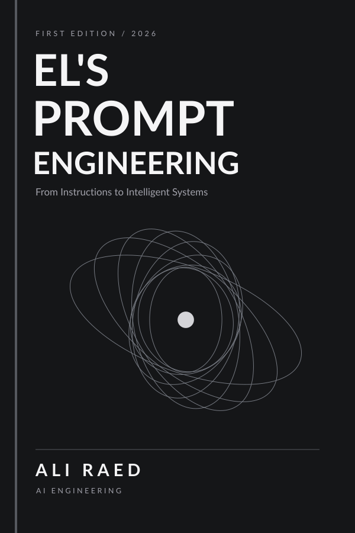

<div align="center">



# EL's Prompt Engineering

### From Instructions to Intelligent Systems

**Ali Raed · First Edition · 2026**

`96 pages` &nbsp; `12 chapters` &nbsp; `English` &nbsp; `AI Engineering`

[**Read the book**](BOOK.md) · [**Explore the chapters**](#contents) · [**EL.ai**](https://elsai.space/)

</div>

---

A practical introduction to AI engineering, covering prompt design, context engineering, retrieval, tool calling, security, evaluation, and real-world applications. Chapter 12 discusses EL.ai, a bilingual AI application project.

## Read the book

[Read the complete first edition online](BOOK.md) · [Visit the author’s AI project, EL.ai](https://elsai.space/)

The original PDF edition is prepared separately for upload.

## Contents

1. [AI Engineering: The System Perspective](chapters/01.md)
2. [Understanding Language Models](chapters/02.md)
3. [Anatomy of a Prompt](chapters/03.md)
4. [Fundamental Prompting Techniques](chapters/04.md)
5. [Advanced Prompt Engineering](chapters/05.md)
6. [System Prompts and Model Behavior](chapters/06.md)
7. [Context Engineering and Retrieval](chapters/07.md)
8. [AI Agents and Tool Calling](chapters/08.md)
9. [Prompt Security and Safety](chapters/09.md)
10. [Evaluation and Optimization](chapters/10.md)
11. [Building Real-World AI Applications](chapters/11.md)
12. [EL.ai: An Engineering Case Study and Roadmap](chapters/12.md)

## Companion examples

[Python examples and tests](examples/) — Python 3.10+, no API key or third-party packages required.

```bash
python -m unittest discover -s examples -v
```

## About this edition

AI-assisted drafting and editing were used. The EL.ai case study reflects reported project experience, not an independent audit. The examples are educational; verify technical assumptions for your own deployments. No public reuse license has been granted.

> A prompt defines intent. Engineering makes that intent reliable.
